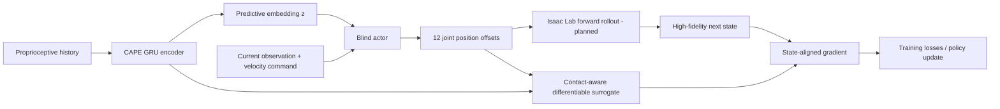

# CAPE-DiffLoco

**Contact-Aware Predictive Embedding for Differentiable Quadruped Locomotion**

A research-oriented implementation scaffold for investigating **blind, proprioception-based quadruped locomotion** with predicted future foot contacts and differentiable dynamics. The intended target is Unitree Go1, with a high-fidelity Isaac Lab forward simulator and a smooth contact-aware single-rigid-body surrogate for backward gradients.

> **Project status: experimental scaffold — not a full paper reproduction yet.** The publicly available code can run a **CPU-only synthetic smoke test** of tensor shapes, contact encoder, actor and differentiable state alignment. It **cannot currently train or evaluate a policy in Isaac Lab**, reproduce numerical paper tables, or safely deploy to Go1. See [reproducibility status](docs/REPRODUCIBILITY.md) before citing results.

## Method at a glance



1. A **high-fidelity simulator** generates state transitions and training-only contact labels.
2. A **GRU contact predictor** processes recent proprioceptive history of length `H=10`, predicting `K=5` future contact steps and a `16`-dimensional predictive embedding.
3. The **actor** uses current proprioception and the predicted embedding to output twelve joint-position offsets.
4. During training, a **contact-aware differentiable surrogate** offers gradients through a state-aligned transition: `x_align = x_sim + alpha * (x_diff - x_diff.detach())`.
5. Contact prediction losses and smooth locomotion objectives train the actor and predictor. Deployment would run only the actor and predictor (not the simulator or training-time privileged labels).

**CAPE** means **Contact-Aware Predictive Embedding**, not *Contact-Conditioned State Alignment*. A learned per-state reliability gate was explored in a different prototype, but is **not** asserted here as an implemented CAPE contribution.

## What can be run today?

```bash
python -m venv .venv
source .venv/bin/activate
pip install -e .
python scripts/smoke_test.py --config configs/mock_smoke.yaml
python -m unittest discover -s tests -v
```

The smoke test creates `outputs/mock_smoke/train_log.csv` and `outputs/mock_smoke/checkpoints/latest.pt`. These are **synthetic debugging artifacts, not scientific training results**.

Export a checkpoint from this mock test **only to verify the export mechanism** (not as a deployable walking controller):

```bash
python scripts/export_policy.py --checkpoint outputs/mock_smoke/checkpoints/latest.pt --format torchscript --out outputs/mock_smoke/exported/policy.pt
```

For ONNX export, install the compatible PyTorch ONNX export dependencies for your PyTorch version, then specify `--format onnx`. Neither exported format nor trained weights are committed to this source repository by default.

## Reproducibility status

| Component | Current status |
| --- | --- |
| Proprioceptive contact-prediction network / actor | Implemented as PyTorch modules |
| Fixed-alpha state alignment and gradient unit test | Implemented |
| Contact-modulated SRB surrogate | Simplified demonstration; not a calibrated full robot model |
| End-to-end *synthetic* CPU smoke test | Implemented; gradients checked |
| Isaac Lab environment integration | **Not implemented** — explicit adapter stub |
| Realistic PD/Jacobian-to-contact-force mapping | **Not implemented** in Isaac pipeline |
| Multi-step physically consistent BPTT | **Not implemented** in Isaac pipeline |
| PPO / DiffSim / ablation baseline training | **Not implemented** |
| Simulation and real-world episode evaluations | **Not implemented** |
| Go1 onboard low-level control and safety | **Not implemented** |
| Actual pretrained policy or paper-matching logs | **Not provided** |

See [REPRODUCIBILITY.md](docs/REPRODUCIBILITY.md) for exact requirements and [ISAAC_LAB_INTEGRATION.md](docs/ISAAC_LAB_INTEGRATION.md) for missing interfaces. `configs/train_cape_go1.yaml` is a **target experiment specification, not a working training command**.

## Source layout

```text
configs/                # mock test and proposed Isaac experiment specifications
src/cape_diffloco/      # encoder, actor, surrogate, alignment, loss and runner scaffolding
scripts/                # smoke train, plotting, export, evaluation / logging safeguards
tests/                  # mathematical and shape contracts
docs/                   # reproducibility checklist, deployment and integration documentation
.github/workflows/      # unit and smoke checks
```

## Full experiments — not yet available

For a real replication, an Isaac Lab `ManagerBasedRLEnv` or equivalent needs to provide reproducible forward rollouts, state and contact labels, contact-to-force Jacobian logic, terminal handling, real sensor-consistent observations, and gradient-connected losses. This repository deliberately fails with a clear error instead of silently running a mock environment when the Isaac backend is selected.

Raw trial logs, simulator versions, terrain generators, seeds, robot asset versions, checkpoints, and plotting procedures would then be required to support a paper-results claim. No unpublished numbers have been invented in this repository.

## Reference and attribution

This project builds conceptually on **Learning Quadruped Locomotion Using Differentiable Simulation** and should acknowledge its authors when used in an academic publication. See the accompanying paper draft for further theoretical and experimental context. The code is not presented as the original authors' implementation.

## Contributing

Bug reports, tested environment adapters, ablations, and reproducibility contributions are welcome through GitHub Issues and pull requests. Please distinguish observed results from hypotheses and mock demonstrations. No specific open-source license is granted until the authors choose a license.
